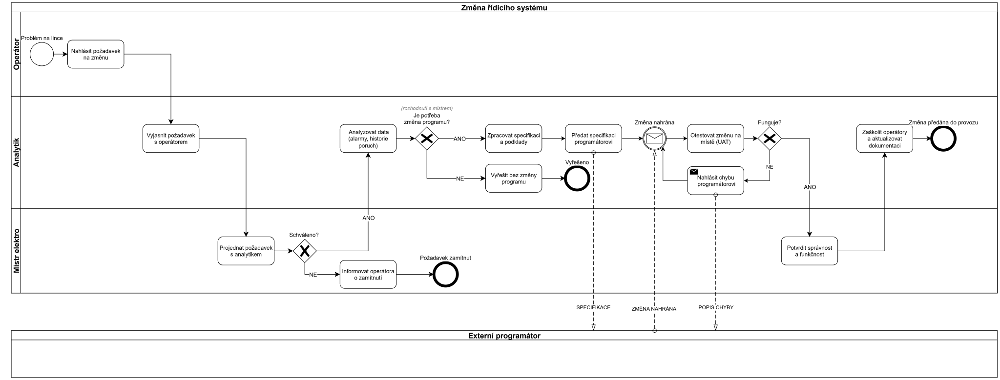
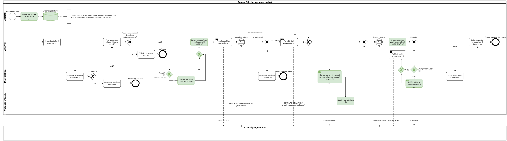

# Analýza procesu: požadavek na změnu průmyslového řídicího systému

[English](README.md) · **Čeština**

Případová studie popisuje, jak se požadavek na změnu řídicího systému výroby (program PLC a vizualizace pro
obsluhu) dostane od nahlášení operátorem až k otestované změně v provozu. Proces je zachycen v notaci
**BPMN 2.0** ve stavu **as-is**, tedy tak, jak dnes skutečně probíhá. Vychází z mé praxe. Druhý diagram ve stavu
**to-be** ukazuje navržené změny procesu, viz [Proces to-be](#proces-to-be).

Zdrojový soubor pro draw.io: [`diagrams/01_as_is_change_process.drawio`](diagrams/01_as_is_change_process.drawio)

## Kontext
Jde o nepřetržitý provoz průmyslových pecí s několika výrobními linkami. Každá linka má vlastní PLC
a vizualizaci (HMI) na velínu.

Požadavky na změny přicházejí od operátorů pravidelně. Typicky jde o nesrozumitelnou chybovou hlášku, hodnotu
zobrazenou v nevhodných jednotkách nebo poruchu, kterou nelze potvrdit bez zásahu údržby. Operátoři je zapisují
do knihy požadavků na velínu. Akutní požadavky se řeší okamžitě. Ostatní, obvykle drobné úpravy, se shromažďují
a externí programátor je provede v jedné zakázce.

Programování zajišťuje externí dodavatel řídicího systému Simatic. Analytickou část změn mám na starosti od roku
2022, souběžně s prací elektrotechnika.

Studie je anonymizovaná a neobsahuje názvy firmy, linek, strojů ani osob.

## Role
| Role | Odpovědnost |
|------|-------------|
| Operátor | nahlašuje požadavek, v běžném provozu potvrzuje funkčnost změny |
| Analytik (moje role) | vyjasnění požadavku, analýza historie alarmů a poruch, specifikace, test na místě (UAT), zaškolení operátorů, dokumentace |
| Mistr elektro | schválení požadavku, spolurozhodnutí o změně programu a o vyjádření programátora, potvrzení výsledku, rozhodnutí o návratu na původní verzi |
| Externí programátor | vyjádření ke specifikaci, implementace a nahrání změny. Jako samostatná organizace má v diagramu vlastní pool |
| Vedoucí provozu | plánování odstávek. V diagramu to-be má vlastní dráhu |

## Hranice procesu
Proces začíná problémem na lince a končí jedním ze čtyř výsledků:
- požadavek je zamítnut,
- problém je vyřešen bez změny programu,
- změnu nelze technicky provést,
- změna je předána do provozu.

Fakturace dodavatele do rozsahu nepatří, jde o samostatný proces.

## Klíčová rozhodnutí
1. **Schváleno?** Mistr posoudí, zda má požadavek smysl řešit.
2. **Je potřeba změna programu?** Rozhoduje analytik společně s mistrem na základě analýzy historie alarmů
   a poruch. Část problémů se vyřeší bez zásahu do programu.
3. **Lze realizovat?** Programátor se ke specifikaci vyjádří a mistr dostane jeho odpověď v kopii. Analytik
   s mistrem pak rozhodnou podle odpovědi. Změnu lze provést podle specifikace, nebo programátor navrhne jiné
   řešení a analytik mu ho potvrdí, nebo změnu technicky provést nelze a mistr o tom informuje operátora.
4. **Funguje?** Změna se ověřuje přímo na místě (UAT). Pokud nefunguje, analytik předá programátorovi popis chyby
   a změna se vrací k přepracování, dokud test neprojde.

## Řízení rizik
Změny se nahrávají výhradně při odstávce, nikdy za výroby. Pece jsou v režimu stand-by, technologie stojí a běží
pouze chladicí dmychadla, která chrání hořáky před poškozením vysokou teplotou.

Dodavatel uchovává zálohu programu a v případě potřeby dokáže vzdáleně obnovit původní verzi (rollback).
O návratu rozhoduje mistr.

Specifikace a běžná komunikace s dodavatelem probíhá e-mailem. Akutní problémy se řeší telefonicky
a vzdáleným připojením.

## Můj podíl a příklady změn
U každé změny vyjasňuji s operátorem, co skutečně potřebuje, připravuji podklady pro programátora, testuji
výsledek na místě a po schválení zaškolím obsluhu a doplním dokumentaci. Několik změn, které tímto procesem
prošly:

- **Otáčky dmychadla v procentech.** Operátor zadával otáčky v ot/min, se kterými v praxi nepracuje. Po změně
  zadává procenta a přepočet provádí program.
- **Srozumitelná chybová hláška.** Hláška zobrazovala pouze kód pohonu. Programátorovi jsem předal přesné datum
  a čas poruchy. Podle nich dohledal v historii příčinu (přetížení frekvenčního měniče) a hláška ji nyní uvádí.
- **Kvitace poruch z velínu.** Vybrané poruchy frekvenčních měničů lze potvrdit přímo z velínu. Dříve musel
  elektrikář dojít na rozvodnu, což podle mé zkušenosti trvalo zhruba 10 až 60 minut. Nyní to operátor zvládne
  přibližně za 20 sekund.

## Modelovací rozhodnutí
- Externí programátor je samostatný pool, nikoli dráha. Jde o jinou organizaci, jejíž vnitřní kroky nejsou
  známé ani řízené z naší strany. S procesem ho propojují pouze toky zpráv: specifikace, vyjádření programátora,
  souhlas s návrhem, nahrání změny a popis chyby.
- Tok procesu (plná šipka) nepřechází mezi pooly. Komunikace mezi organizacemi je vyjádřena tokem zpráv
  (čárkovaná šipka).
- Společné rozhodnutí analytika a mistra je kvůli přehlednosti zakresleno jako brána v dráze analytika
  s poznámkou.
- Jiný návrh programátora byl zatím vždy přijat. Brána „Přijmout návrh?“ proto v as-is není, model zachycuje
  skutečný průběh.
- Před událostí „Změna nahrána“ je slučovací brána. Spojuje tři cesty: změnu podle specifikace, potvrzený návrh
  programátora a opravu po nahlášené chybě.

## Omezení modelu as-is
- Rollback ani plánování odstávky nejsou v diagramu zakresleny. Verze to-be by je doplnila jako samostatné kroky
  včetně rozhodnutí mistra, zda se vrací původní verze, nebo se chyba opraví.
- Diagram sleduje jeden požadavek a nerozlišuje akutní a dávkové změny. Verze to-be by přidala bránu „Akutní?“
  a krok sběru drobných změn do dávky.
- Kniha požadavků je vedena papírově. Digitální evidence (datum, žadatel, priorita, rozhodnutí, stav) by umožnila
  sledovat počet změn a dobu jejich vyřízení.
- Akceptační kritéria se domlouvají ústně až při testu. Pokud by byla součástí specifikace, test by byl
  opakovatelný a výsledek jednoznačný.

Všechna čtyři omezení řeší proces to-be v další části.

## Proces to-be

Zdrojový soubor pro draw.io: [`diagrams/02_to_be_change_process.drawio`](diagrams/02_to_be_change_process.drawio)

Zeleně jsou kroky, které se proti as-is mění nebo přibývají. Číslo v závorce odpovídá řádku tabulky. Do procesu
přibyla dráha Vedoucí provozu, protože termín odstávky určuje on. Odpověď programátora na specifikaci
a rozhodnutí „Lze realizovat?“ probíhají stejně jako v as-is, proto nejsou zelené.

| Č. | As-is | To-be | Přínos | Co je potřeba zavést |
|----|-------|-------|--------|----------------------|
| 1 | Požadavky se zapisují do papírové knihy na velínu. | Operátor zapíše požadavek do evidence s pevnými údaji: datum, žadatel, linka, popis, návrh priority, rozhodnutí a stav. Stav se aktualizuje při každém rozhodnutí a uzavření. | Je vidět, kolik požadavků přichází, jak dlouho trvá jejich vyřízení a kolik se jich zamítne. | Sdílená tabulka nebo seznam s pevnými sloupci a pravidlo, kdo stav aktualizuje. |
| 2 | Proces nerozlišuje akutní a drobné změny. | Mistr rozhodne, zda je změna akutní, tedy zda ohrožuje provoz. Operátor akutnost navrhuje. Akutní změna jde rovnou do specifikace. Drobné změny se zařadí do dávky a programátorovi se předají, až je jich víc. | Akutní problém nečeká. Drobné změny se provedou v jedné zakázce a v jedné odstávce. | Jasné kritérium, co je akutní. |
| 3 | Odstávka je jen předpoklad nahrání, v procesu není. | Mistr dohodne termín nahrání s programátorem a vedoucím provozu. Vedoucí provozu naplánuje odstávku a programátor dostane termín zprávou. | Nahrání je vždy navázané na konkrétní odstávku a je jasné, kdo termín určuje. | Pravidlo, že akutní změna se nahrává v mimořádné odstávce a dávka v plánované. |
| 4 | Akceptační kritéria se domlouvají ústně až při testu. | Specifikace obsahuje akceptační kritéria a test na místě probíhá podle nich. | Test je opakovatelný a výsledek jednoznačný. | Šablona specifikace s oddílem pro akceptační kritéria. |
| 5 | Rollback ani rozhodnutí o něm nejsou v procesu vidět. | Pokud změna nefunguje, mistr rozhodne, zda se vrací původní verze. Pokud ano, nařídí programátorovi rollback. V obou případech analytik předá programátorovi popis chyby. | Nefunkční změna nezůstane v provozu bez rozhodnutí a je jasné, kdo rozhoduje. | Pravidlo, kdy se vrací původní verze. Zálohu programu drží programátor už dnes. |

Evidence požadavků umožní sledovat tyto ukazatele:
- počet požadavků za měsíc,
- průměrnou dobu od zápisu požadavku po předání do provozu,
- podíl zamítnutých požadavků,
- podíl akutních změn.

Modelovací rozhodnutí v to-be:
- Kde se dvě cesty znovu spojují, je slučovací brána. Tok tak zůstává jednoznačný.
- Evidence požadavků je úložiště dat. Tečkovaná čára znázorňuje zápis dat, ne tok procesu.
- Pravidla, která nejsou krokem procesu (například kdy se dávka předá programátorovi), jsou v tabulce, ne
  v diagramu. Diagram tak zůstává čitelný.

## Soubory
- `diagrams/` diagramy BPMN as-is a to-be (zdroj pro draw.io, SVG a PNG)
- `docs/process_description.md` popis jednotlivých kroků procesu as-is s rolí, vstupem, výstupem a pravidlem
- [`docs/specification_fm_reset_cz.md`](docs/specification_fm_reset_cz.md) specifikace změny „Kvitace poruch
  z velínu“ s požadavky, obchodními pravidly a akceptačními kritérii

Autor: David Tejkl · [LinkedIn](https://www.linkedin.com/in/david-tejkl) · [další projekty na GitHubu](https://github.com/DavidTejkl)
